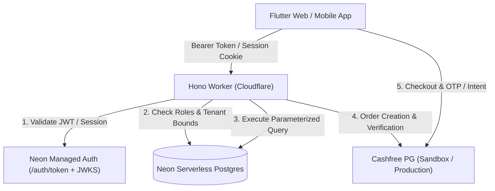

# Schoolic - Comprehensive Project Overview

## Overview
**Schoolic** is an enterprise-grade, lightweight, and modern school management platform built for speed, functional clarity, and zero-cost cloud scalability. It empowers educational institutions to seamlessly operate administrative pipelines, academic scheduling, student attendance, homework management, examinations & grading, admissions, and institutional fee payments with digital invoicing.

---

## Design System & Typography
* **Design Philosophy:** "Reduce visual noise. Increase functional precision."
* **Typography:** **Switzer** (official Fontshare font assets bundled locally in `assets/fonts/switzer/` under the Fontshare Free License).
  * Scale: Display (32px), Page Title (26px), Section Heading (20px), Subsection Heading (16px), Body (14px), Compact Table (13px), Labels & Metadata (12px).
* **Strict Monochrome Visual System:**
  * Primary text: `#111111`
  * Main background: `#FFFFFF`
  * Secondary background: `#F7F7F7`
  * Primary border: `#E5E5E5`
  * Secondary border: `#D4D4D4`
  * Secondary text: `#737373`
  * Muted text: `#A3A3A3`
  * Interactive accent: `#10A37F` (Emerald Green)
* **Prohibitions:** Zero gradients, no neon/glows, no glassmorphism, no decorative blobs, no card-based statistic clutter, no emoji icons.

---

## Tech Stack
* **Frontend Client:** Flutter Web and native Flutter targets for Android, Windows, and Linux (Material 3, Flutter Riverpod, GoRouter).
* **Payment Gateway SDK:** Cashfree Payment Gateway v3 JS SDK (`https://sdk.cashfree.com/js/v3/cashfree.js`) and Server-to-Server REST integration.
* **Document Generation:** Client-side vector PDF generation (`pdf` and `printing` packages) for official fee receipts, invoices, student IDs, and report cards.
* **Backend API:** Hono / TypeScript running on Cloudflare Workers edge network.
* **Database:** Neon Serverless PostgreSQL with pooled and unpooled connection pooling.
* **ORM & Migrations:** Drizzle ORM (`drizzle-orm`, `drizzle-kit`).
* **Authentication:** Neon Managed Auth / Better Auth with JWT bearer verification and fail-closed security.
* **Hosting:** Cloudflare Pages (Frontend Web) & Cloudflare Workers (Backend API).
* **Hardware/Mobile:** Production Android Release APK (`com.zephvion.schoolic`) deployed directly to physical devices.

---

## Architecture & Security Model



### Security Controls
1. **Server-Side Session Verification:** Authenticates Neon Auth JWT bearer tokens with the branch JWKS and keeps cookie session fallback fail-closed.
2. **Environment Separation & Bypass Neutralization:**
   - In production and staging (`APP_ENV !== 'development'`), dev headers (`x-dev-neon-user-id`, `x-dev-email`) are strictly ignored.
   - Fail-closed design: missing auth configuration triggers immediate HTTP 500 without granting access.
3. **Role-Based & Object-Level Access Control (RBAC & OBAC):**
   - Administrators possess full school management access (classes, staff, admissions, fees, timetable, overview).
   - Teachers are strictly constrained to classes and sections assigned to them in `teacherAssignments`.
   - Students and parents have dedicated portal views constrained strictly to their own enrolled records.
4. **Spreadsheet Formula Injection Defense (CWE-1236):**
   - Exported CSV fields starting with `=`, `+`, `-`, `@`, `\t`, or `\r` are sanitized by prepending a single quote (`'`).
5. **Payment Gateway Security:**
   - Cashfree API keys strictly separated: public App ID configured in environments, Secret Key stored in encrypted Cloudflare Worker Secrets (`wrangler secret put CASHFREE_SECRET_KEY`).
   - HMAC-SHA256 signature verification for Cashfree webhooks using `crypto.subtle`.
6. **CORS Hardening:**
   - Explicit allowed origin list with credentials; wildcard origins prohibited.
7. **Timing Attack Protection:**
   - Bootstrap tokens verified using `crypto.subtle.timingSafeEqual`.

---

## Core Functional Modules

### 1. Admissions & Operations (Phase 8.5)
- Prospective inquiry management, formal application submission, status transitions (`inquiry`, `applied`, `under_review`, `approved`, `enrolled`, `rejected`).
- Document verification checklist: birth certificates, transfer certificates, address proofs, and photos with staff verification tracking.
- Class intake capacity tracker with visual progress bars.
- One-click student enrollment assigning student admission ID, section, and roll number.

### 2. Fees & Finance with Cashfree Payment Gateway (Phase 8.4 & 8.6)
- Fee structure definition (amount, frequency: one-time, term, monthly, annual, and due dates).
- Student fee allocations with dynamic balance due calculations.
- Live billing metrics: Total Billed, Total Collected, Outstanding Due, and Overdue Dues.
- **Cashfree PG Integration**:
  - Full balance checkout and custom partial installment payments.
  - Multi-channel payments: UPI Collect (`testsuccess@gocash`), Cards, Netbanking.
  - Interactive payment authorization sheet with live order creation (`/api/v1/portal/fees/orders`).
  - Automated sandbox session pay and simulation (`POST /pg/simulate` with `entity: "PAYMENTS"`).
  - Official institutional receipt generation (`REC-YYYY-XXXXX`), payment history ledger, and printable PDF invoice generation via `printing` and `pdf`.

### 3. Student & Parent Portal (Phase 8.3 & 8.6)
- Digital Student ID card with student photo placeholder, school code, emergency contact, and enlargable QR code.
- Assigned fee schedules, status badges (`PAID`, `PARTIAL`, `OVERDUE`, `PENDING`), and instant online payment action.
- Payment receipts archive with one-click PDF invoice generation and printing.
- Timetable, assignments, homework submissions, and attendance review.

### 4. Examinations, Marks & Report Cards (Phase 8.2)
- Multi-term exam creation, subject max/passing mark configuration, and grading scales.
- Teacher marks entry with validation against maximum marks.
- Report card generation with automated GPA/percentage calculations, teacher remarks, and printable student transcripts.

### 5. Attendance & Timetable (Phase 5.2 & 5.3)
- Multi-period daily schedule configuration with conflict detection (teacher overlap, room collisions).
- Daily roll call register with real-time status counters (`Present`, `Absent`, `Late`, `Excused`).
- CSV export with CSV injection sanitization.
- Attendance analytics and student attendance history.

### 6. Homework & Teaching Materials (Phase 7.0 & 8.0)
- Homework assignment composer with due dates and submission tracking.
- Student submission workflow with student response text and attachments.
- Teacher review and grading feedback.

---

## Environment Configuration & Secrets

### Cloudflare Worker Environments (`services/api/wrangler.jsonc`)

| Environment | Variable Name | Purpose | Example Value |
|---|---|---|---|
| Development | `APP_ENV` | Runtime environment mode | `development` |
| Development | `CORS_ORIGIN` | Allowed web origins | `http://localhost:8080,http://127.0.0.1:8080` |
| Development | `NEON_AUTH_URL` | Neon Auth verification endpoint | `http://localhost:8787` |
| Development | `CASHFREE_APP_ID` | Cashfree Gateway Client ID | `TEST112097243d3d637f11e796a7739842790211` |
| Development | `CASHFREE_ENV` | Gateway environment mode | `sandbox` |
| Development | `CASHFREE_API_VERSION` | Gateway REST API version | `2023-08-01` |
| Staging | `APP_ENV` | Runtime environment mode | `staging` |
| Staging | `CORS_ORIGIN` | Allowed web origins | `https://schoolic-staging.pages.dev` |
| Staging | `NEON_AUTH_URL` | Neon Auth root endpoint | `https://ep-billowing-shadow-b56k9cl2.neonauth.c-7.us-east-2.aws.neon.tech/neondb` |
| Staging | `CASHFREE_APP_ID` | Cashfree Gateway Client ID | `TEST112097243d3d637f11e796a7739842790211` |
| Staging | `CASHFREE_ENV` | Gateway environment mode | `sandbox` |
| Staging | `CASHFREE_API_VERSION` | Gateway REST API version | `2023-08-01` |
| Production | `APP_ENV` | Runtime environment mode | `production` |
| Production | `CORS_ORIGIN` | Allowed web origins | `https://schoolic.pages.dev` |
| Production | `NEON_AUTH_URL` | Neon Auth Base URL | `https://ep-polished-silence-b52ozwm7.neonauth.c-7.us-east-2.aws.neon.tech/neondb/auth` |
| Production | `CASHFREE_APP_ID` | Cashfree Gateway Client ID | `TEST112097243d3d637f11e796a7739842790211` |
| Production | `CASHFREE_ENV` | Gateway environment mode | `sandbox` |
| Production | `CASHFREE_API_VERSION` | Gateway REST API version | `2023-08-01` |

### Encrypted Secrets (Managed via Cloudflare Wrangler)
```bash
# Production Secrets
pnpm wrangler secret put DATABASE_URL --env production
pnpm wrangler secret put CASHFREE_SECRET_KEY --env production
pnpm wrangler secret put BOOTSTRAP_TOKEN --env production
pnpm wrangler secret put AI_API_KEY --env production

# Staging Secrets
pnpm wrangler secret put DATABASE_URL --env staging
pnpm wrangler secret put CASHFREE_SECRET_KEY --env staging
pnpm wrangler secret put BOOTSTRAP_TOKEN --env staging
pnpm wrangler secret put AI_API_KEY --env staging
```

---

## Live Deployment Targets

| Service | Environment | URL / Target | Status |
|---|---|---|---|
| **Web Client** | Production | `https://schoolic.pages.dev` | **Live & Active** |
| **Web Client** | Staging | `https://schoolic-staging.pages.dev` | **Live & Active** |
| **Edge API Worker** | Production | `https://schoolic-api.schoolic-api.workers.dev` | **Live & Active** |
| **Edge API Worker** | Staging | `https://schoolic-api-staging.schoolic-api.workers.dev` | **Live & Active** |
| **Mobile Client** | Android Release APK | `com.zephvion.schoolic` | **Installed on physical device** |

---

## Verification & Test Commands

```bash
# Run Vitest test suite (60/60 tests passing, including Cashfree Sandbox integration)
pnpm api:test

# Run API type checking (0 errors)
pnpm api:typecheck

# Run Flutter static analyzer (0 issues)
cd apps/flutter_app && flutter analyze

# Run Flutter widget and payment flow tests (54/54 tests passing)
pnpm flutter:test
```
