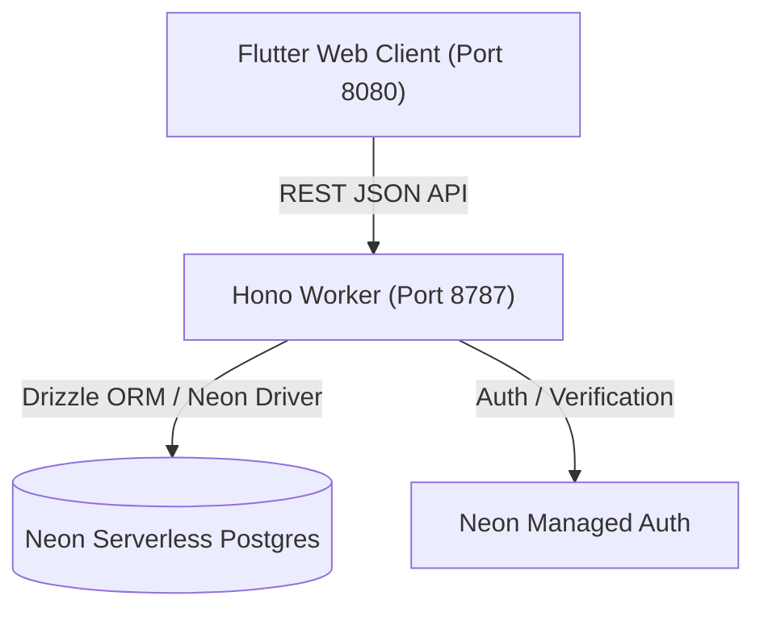

# Schoolic - V1 Pilot MVP

## Overview
Schoolic is a lightweight, modern school management application designed for a focused V1 pilot launch. It provides foundational capabilities for school administrators to configure academic structures, staff, and students, and enables teachers to record daily and period-based attendance with real-time feedback.

---

## Design System & Typography
* **Design Philosophy:** "Reduce visual noise. Increase functional precision."
* **Typography:** **Switzer** (official Fontshare font assets bundled locally in `assets/fonts/switzer/` under the Fontshare Free License).
  * Scale: Display (32px), Page Title (26px), Section Heading (20px), Subsection Heading (16px), Body (14px), Compact Table (13px), Labels & Metadata (12px).
* **Strict Monochrome Visual System:**
  * Primary text: `#111111`
  * Main background: `#FFFFFF`
  * Secondary background: `#F7F7F7`
  * Primary border: `#E5E5E5`
  * Secondary border: `#D4D4D4`
  * Secondary text: `#737373`
  * Muted text: `#A3A3A3`
  * Interactive accent: `#10A37F`
* **Prohibitions:** Zero gradients, no neon/glows, no glassmorphism, no decorative blobs, no card-based statistic clutter, no emoji icons.

---

## Tech Stack
* **Frontend:** Flutter Web (Material 3, Flutter Riverpod for state management, GoRouter for declarative routing).
* **Backend API:** Hono / TypeScript (targeting Cloudflare Workers with Wrangler).
* **Database:** Neon Serverless PostgreSQL.
* **ORM:** Drizzle ORM.
* **Authentication:** Neon Managed Auth (with local dev session bypass headers `x-dev-neon-user-id` and `x-dev-email` for rapid testing).

---

## Architecture & Components

* **`apps/flutter_app`**:
  * `lib/src/core/theme.dart`: Centralized `AppColors`, `AppTypography` token hierarchy, and `buildSchoolicTheme()`.
  * `lib/src/features/shared/shell.dart`: Minimal application shell with quiet top bar for non-admin views and shared layout helpers.
  * `lib/src/features/admin/admin_dashboard.dart`: Complete Admin Dashboard featuring:
    * Collapsible Left Navigation Sidebar (230px) with typographic wordmark `schoolic.` and monochrome Lucide-style outline icons.
    * Quiet Top Bar (52px) with academic year pill (`2026-2027`), compact search, notifications popover, and profile info.
    * Integrated statistics region with thin vertical dividers (Total Students, Teaching Staff, Classes & Sections, Today's Attendance).
    * "Needs attention" operational tasks.
    * "Recent attendance" register table with `View all →`.
    * "Quick access" monochrome links.
    * Dedicated views for Attendance Register (with CSV export & filters), Students Directory (with modal profile), Staff, Classes & Subjects, Teacher Assignments, Reports, and System Settings.
  * `lib/src/features/teacher`: Class assignment roster views, Daily/Period attendance tracker, and SnackBar feedback.
  * `lib/src/core`: API client, data models, state providers, CSV web exporter, and router guards.
* **`services/api`**:
  * `src/routes`: Admin, Teacher, and Me routes with Zod validation.
  * `src/repositories`: Drizzle-backed database repository with relational joins, filtering, and aggregation queries.
  * `src/db/schema.ts`: Database schemas for academic structures, users, staff, students, assignments, attendance sessions, and attendance records.

---

## Core Features (V1 Status: Complete)

### Admin Role
- **Minimalist Operational Dashboard:** Overview screen delivering immediate school state within five seconds.
- **Academic Structure Setup:** Create and manage Academic Years, Classes, Sections, and Subjects.
- **Directory Management:** Manage Staff (Teachers) and Students with automatic roll/admission number tracking.
- **Teacher Assignments:** Assign teachers to specific class sections and subjects with permissions for daily or period attendance.
- **Reporting Filters & CSV Export:** Filter attendance sessions by Class, Section, and Date range, with one-click browser CSV export.
- **Student Attendance Profile:** Click any student to view their attendance history modal with percentage rate, status counters, and session records.

### Teacher Role
- **Teacher Dashboard:** View assigned classes and sections with human-readable labels.
- **Interactive Attendance Tracking:** Mark student attendance (Present, Absent, Late, Excused) for either full days or specific periods.
- **Instant Save & SnackBar Feedback:** Submit attendance directly to Postgres with instant visual confirmations.

---

## Current Roadmap (Next Phases)

### Phase 2: Production Deployment & Auth Hardening (Next Up)
1. **Neon Auth Production Exchange:** Connect live Better Auth bearer tokens in place of dev headers.
2. **Cloudflare Worker Deployment:** Configure Wrangler secrets and deploy API to Cloudflare (`api-school.zephvion.com`).
3. **Flutter Web Production Build & Hosting:** Build `flutter build web --release` and deploy to Cloudflare Pages or static CDN.

### Phase 3: Post-V1 Enhancements
- Student attendance analytics & trend forecasting.
- Document and media attachments (excused absence notes).
- Dedicated Parent and Student portals.
- Fee and billing management.
