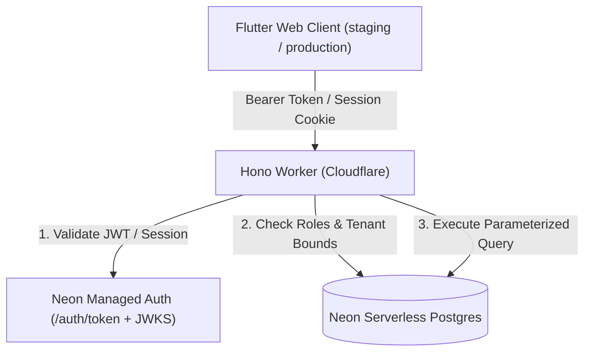

# Schoolic - V1 Pilot MVP

## Overview
Schoolic is a lightweight, modern school management application designed for a focused V1 pilot launch. It provides foundational capabilities for school administrators to configure academic structures, staff, students, and weekly timetables, and enables teachers to view schedules and record daily or period-based attendance with real-time feedback.

---

## Design System & Typography
* **Design Philosophy:** "Reduce visual noise. Increase functional precision."
* **Typography:** **Switzer** (official Fontshare font assets bundled locally in `assets/fonts/switzer/` under the Fontshare Free License).
  * Scale: Display (32px), Page Title (26px), Section Heading (20px), Subsection Heading (16px), Body (14px), Compact Table (13px), Labels & Metadata (12px).
* **Strict Monochrome Visual System:**
  * Primary text: `#111111`
  * Main background: `#FFFFFF`
  * Secondary background: `#F7F7F7`
  * Primary border: `#E5E5E5`
  * Secondary border: `#D4D4D4`
  * Secondary text: `#737373`
  * Muted text: `#A3A3A3`
  * Interactive accent: `#10A37F`
* **Prohibitions:** Zero gradients, no neon/glows, no glassmorphism, no decorative blobs, no card-based statistic clutter, no emoji icons.

---

## Tech Stack
* **Frontend:** Flutter Web and native Flutter targets for Android, Windows, and Linux (Material 3, Flutter Riverpod, GoRouter).
* **Backend API:** Hono / TypeScript (Cloudflare Workers runtime).
* **Database:** Neon Serverless PostgreSQL.
* **ORM:** Drizzle ORM.
* **Authentication:** Neon Managed Auth / Better Auth with server-side session token verification and fail-closed security.
* **Hosting:** Cloudflare Pages (Frontend Web) & Cloudflare Workers (Backend API).
* **Native CI Artifacts:** Manual GitHub Actions staging workflow for Android APK, Windows ZIP, and Linux TAR.GZ builds.

---

## Architecture & Security Model



### Security Controls
1. **Server-Side Session Verification:** Authenticates Neon Auth JWT bearer tokens with the branch JWKS and keeps cookie session fallback fail-closed.
2. **Environment Separation & Bypass Neutralization:**
   - In production and staging (`APP_ENV !== 'development'`), dev headers (`x-dev-neon-user-id`, `x-dev-email`) are strictly ignored.
   - Fail-closed design: missing auth configuration triggers immediate HTTP 500 without granting access.
3. **Role-Based & Object-Level Access Control (RBAC & OBAC):**
   - Administrators possess full school management access.
   - Teachers are strictly constrained to classes and sections assigned to them in `teacherAssignments`.
   - Attendance submission verifies enrolled students before persisting attendance rows.
4. **Spreadsheet Formula Injection Defense (CWE-1236):**
   - Exported CSV fields starting with `=`, `+`, `-`, `@`, `\t`, or `\r` are sanitized by prepending a single quote (`'`).
5. **CORS Hardening:**
   - Explicit allowed origin list with credentials; wildcard origins prohibited.
6. **Timing Attack Protection:**
   - Bootstrap tokens verified using `crypto.subtle.timingSafeEqual`.

---

## Environment Configuration & Secrets

### Cloudflare Worker Environments (`services/api/wrangler.jsonc`)

| Environment | Variable Name | Purpose | Example Value |
|---|---|---|---|
| Development | `APP_ENV` | Runtime environment mode | `development` |
| Development | `CORS_ORIGIN` | Allowed web origins | `http://localhost:8080,http://127.0.0.1:8080` |
| Development | `NEON_AUTH_URL` | Neon Auth verification endpoint | `http://localhost:8787` |
| Staging | `APP_ENV` | Runtime environment mode | `staging` |
| Staging | `CORS_ORIGIN` | Allowed web origins | `https://schoolic-staging.pages.dev` |
| Staging | `NEON_AUTH_URL` | Neon Auth root endpoint | `https://ep-billowing-shadow-b56k9cl2.neonauth.c-7.us-east-2.aws.neon.tech/neondb` |
| Staging | `AI_FEATURES_ENABLED` | Enables backend-only AI routes | `true` |
| Staging | `AI_PROVIDER` | Server-side AI adapter type | `openai-compatible` |
| Staging | `AI_MODEL` | Staging AI model | `qwen/qwen3.8-27b` |
| Staging | `AI_BASE_URL` | Staging OpenAI-compatible base URL | `https://api.groq.com/openai/v1` |
| Staging | `AI_MAX_OUTPUT_TOKENS` | Server-enforced output-token ceiling | `1200` |
| Staging | `AI_TIMEOUT_MS` | Provider request timeout | `18000` |
| Staging | `AI_REQUESTS_PER_USER` | Per-user generation limit | `20` |
| Staging | `AI_REQUEST_WINDOW_MINUTES` | Per-user generation limit window | `60` |
| Production | `APP_ENV` | Runtime environment mode | `production` |
| Production | `CORS_ORIGIN` | Allowed web origins | `https://schoolic.pages.dev` |
| Production | `NEON_AUTH_URL` | Neon Auth Base URL | `https://ep-polished-silence-b52ozwm7.neonauth.c-7.us-east-2.aws.neon.tech/neondb/auth` |

### Required Staging Secrets (Cloudflare Worker)
Configure via `wrangler secret put --env staging`:

```bash
# 1. Staging Neon database connection string (isolated staging branch)
pnpm wrangler secret put DATABASE_URL --env staging

# 2. Staging school bootstrap token
pnpm wrangler secret put BOOTSTRAP_TOKEN --env staging

# 3. Staging AI provider credential, server-side only
pnpm wrangler secret put AI_API_KEY --env staging
```

---

## Available Scripts

### Development & Testing
```bash
# Start backend API locally (Port 8787)
pnpm api:dev

# Start frontend Flutter Web locally (Port 8080)
pnpm flutter:dev

# Run API type checking (0 errors)
pnpm api:typecheck

# Run Vitest test suite (22/22 tests passed)
pnpm api:test

# Run Flutter static analyzer (0 issues)
cd apps/flutter_app && flutter analyze

# Run Flutter widget tests (100% passed)
pnpm flutter:test
```

### Build & Release
```bash
# Generate database migrations
pnpm db:generate

# Apply pending database migrations using unpooled connection
pnpm db:migrate

# Build Flutter Web for staging (schoolic-staging.pages.dev) -> output: build/web_staging
pnpm flutter:build:web:staging

# Build Flutter Web for production (schoolic.pages.dev) -> output: build/web_prod
pnpm flutter:build:web:prod

# Dry-run Worker staging deployment
pnpm --filter @schoolic/api exec wrangler deploy --env staging --dry-run

# Deploy Worker to Staging
pnpm api:deploy:staging

# Deploy Frontend to Staging Pages
pnpm pages:deploy:staging

# Deploy Worker to Production
pnpm api:deploy:prod

# Deploy Frontend to Production Pages
pnpm pages:deploy:prod
```

---

## Staging Deployment & Handover Status

### Verified Staging Progress
- [x] Correct Schoolic Neon project identified: `schoolic` (`dark-frost-36120929`), branch `main` (`br-rapid-lake-b5g9wtix`).
- [x] Prohibited unrelated Neon project `neon-amethyst-pillow` was not used.
- [x] Isolated empty staging Neon project created: `schoolic-staging` (`nameless-dust-81736720`), branch `main` (`br-floral-mountain-b5s114go`).
- [x] Drizzle migrations applied successfully to the isolated staging database using `DATABASE_URL_UNPOOLED`.
- [x] Neon Managed Auth enabled for the isolated staging branch.
- [x] Staging Worker deployed as `schoolic-api-staging` at `https://schoolic-api-staging.schoolic-api.workers.dev`.
- [x] Staging Worker secrets `DATABASE_URL` and `BOOTSTRAP_TOKEN` configured with Wrangler.
- [x] Staging Pages project deployed at `https://schoolic-staging.pages.dev`.
- [x] Dedicated staging artifact built at `apps/flutter_app/build/web_staging`.
- [x] Staging CORS whitelist configured to `https://schoolic-staging.pages.dev`.
- [x] Single-page application route rules deployed in `_redirects`.
- [x] Staging artifact verified to contain default API/auth URLs, Switzer fonts, no localhost references, no production references, and no database URLs.
- [x] Local verification passed: API typecheck, API tests, Flutter analyzer, and Flutter widget tests.
- [x] Live synthetic E2E passed for auth, admin workflows, teacher workflows, attendance persistence, filters, CSV export, and student attendance history.
- [x] Phase 5.3 timetable migration applied to staging only.
- [x] Staging timetable API, admin scheduling UI, teacher daily/weekly schedule views, and seeded synthetic timetable rows verified.

### Phase 3.2 Status
- [x] Complete using Cloudflare default hosting domains.
- [x] Hostinger DNS and `zephvion.com` nameservers were not modified.
- [x] No production Worker, Pages project, database, or production secret was modified.

---

## Production Readiness Status

### Verified Production Identity
- [x] Neon project: `schoolic` (`dark-frost-36120929`).
- [x] Production branch: `main` (`br-rapid-lake-b5g9wtix`).
- [x] Production database: `neondb`.
- [x] Runtime connection source is the pooled production Neon host in ignored local env.
- [x] Migration connection source is the unpooled production Neon host in ignored local env.
- [x] Direct production SQL access works through Neon CLI embedded TypeScript `psql`.
- [x] Production recovery snapshot created before Phase 5.4 timetable release: `snap-curly-hat-b5woqrcz`.
- [x] Drizzle migration history is baselined and `pnpm db:migrate` succeeds.
- [x] Production Worker deployed: `https://schoolic-api.schoolic-api.workers.dev`.
- [x] Production Pages deployed: `https://schoolic.pages.dev`.
- [x] Production synthetic portfolio data seeded for `Schoolic Portfolio Academy` (`PORTFOLIO`).
- [x] Production timetable schema migrated with `0001_harsh_firedrake`.
- [x] Production synthetic portfolio timetable data seeded from existing teacher assignments.
- [x] Production Neon Auth enabled for branch `br-rapid-lake-b5g9wtix`.
- [x] Trusted production auth domain configured: `https://schoolic.pages.dev`.
- [x] Production Worker and Flutter build use the verified production Neon Auth Base URL.
- [x] Designated synthetic admin and teacher accounts are mapped to real Neon Auth user IDs.
- [x] Production authenticated smoke tests pass for admin login, teacher login, RBAC, invalid sessions, and blocked development-bypass headers.
- [x] Production timetable and scheduled attendance smoke tests pass.
- [x] Production bundle targets the default Cloudflare API and Neon Auth URLs and contains no old `zephvion.com`, staging endpoint, or database URL references.

### Production Blockers
- [x] Phase 5.2 UX redesign: Completed and deployed to production.
- [x] Phase 5.3 timetable feature: Completed and deployed to production.
- [ ] Production recovery controls are incomplete: no automatic snapshot schedule or restore drill.

### Approval Gates
- Remaining gates before real pilot use: recurring recovery policy, restore drill, and any future real-user onboarding.
