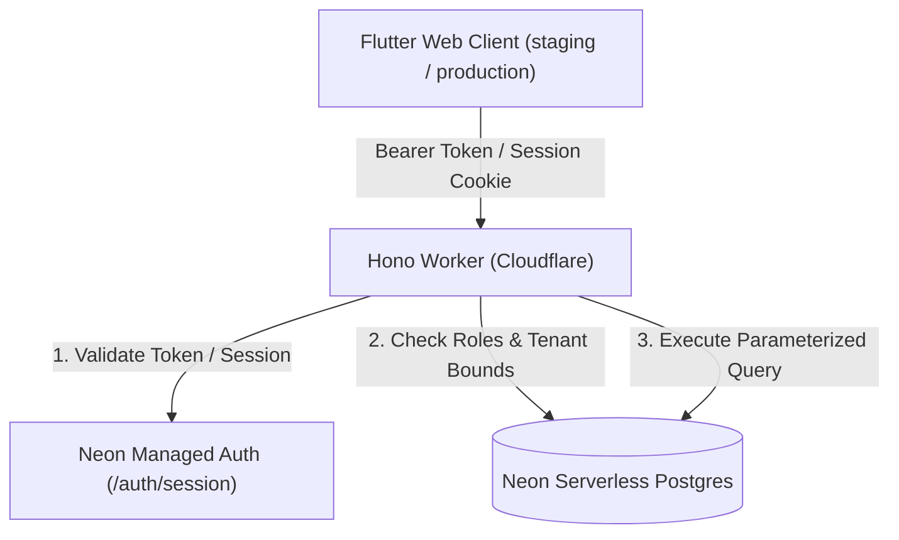

# Schoolic - V1 Pilot MVP

## Overview
Schoolic is a lightweight, modern school management application designed for a focused V1 pilot launch. It provides foundational capabilities for school administrators to configure academic structures, staff, and students, and enables teachers to record daily and period-based attendance with real-time feedback.

---

## Design System & Typography
* **Design Philosophy:** "Reduce visual noise. Increase functional precision."
* **Typography:** **Switzer** (official Fontshare font assets bundled locally in `assets/fonts/switzer/` under the Fontshare Free License).
  * Scale: Display (32px), Page Title (26px), Section Heading (20px), Subsection Heading (16px), Body (14px), Compact Table (13px), Labels & Metadata (12px).
* **Strict Monochrome Visual System:**
  * Primary text: `#111111`
  * Main background: `#FFFFFF`
  * Secondary background: `#F7F7F7`
  * Primary border: `#E5E5E5`
  * Secondary border: `#D4D4D4`
  * Secondary text: `#737373`
  * Muted text: `#A3A3A3`
  * Interactive accent: `#10A37F`
* **Prohibitions:** Zero gradients, no neon/glows, no glassmorphism, no decorative blobs, no card-based statistic clutter, no emoji icons.

---

## Tech Stack
* **Frontend:** Flutter Web (Material 3, Flutter Riverpod, GoRouter).
* **Backend API:** Hono / TypeScript (Cloudflare Workers runtime).
* **Database:** Neon Serverless PostgreSQL.
* **ORM:** Drizzle ORM.
* **Authentication:** Neon Managed Auth / Better Auth with server-side session token verification and fail-closed security.
* **Hosting:** Cloudflare Pages (Frontend Web) & Cloudflare Workers (Backend API).

---

## Architecture & Security Model



### Security Controls
1. **Server-Side Session Verification:** Authenticates bearer tokens and cookies against `NEON_AUTH_URL/auth/session`.
2. **Environment Separation & Bypass Neutralization:**
   - In production and staging (`APP_ENV !== 'development'`), dev headers (`x-dev-neon-user-id`, `x-dev-email`) are strictly ignored.
   - Fail-closed design: missing auth configuration triggers immediate HTTP 500 without granting access.
3. **Role-Based & Object-Level Access Control (RBAC & OBAC):**
   - Administrators possess full school management access.
   - Teachers are strictly constrained to classes and sections assigned to them in `teacherAssignments`.
   - Attendance submission verifies enrolled students before persisting attendance rows.
4. **Spreadsheet Formula Injection Defense (CWE-1236):**
   - Exported CSV fields starting with `=`, `+`, `-`, `@`, `\t`, or `\r` are sanitized by prepending a single quote (`'`).
5. **CORS Hardening:**
   - Explicit allowed origin list with credentials; wildcard origins prohibited.
6. **Timing Attack Protection:**
   - Bootstrap tokens verified using `crypto.subtle.timingSafeEqual`.

---

## Environment Configuration & Secrets

### Cloudflare Worker Environments (`services/api/wrangler.jsonc`)

| Environment | Variable Name | Purpose | Example Value |
|---|---|---|---|
| Development | `APP_ENV` | Runtime environment mode | `development` |
| Development | `CORS_ORIGIN` | Allowed web origins | `http://localhost:8080,http://127.0.0.1:8080` |
| Development | `NEON_AUTH_URL` | Neon Auth verification endpoint | `http://localhost:8787` |
| Staging | `APP_ENV` | Runtime environment mode | `staging` |
| Staging | `CORS_ORIGIN` | Allowed web origins | `https://staging.schoolic.zephvion.com` |
| Staging | `NEON_AUTH_URL` | Neon Auth verification endpoint | `https://staging-auth.schoolic.zephvion.com` |
| Production | `APP_ENV` | Runtime environment mode | `production` |
| Production | `CORS_ORIGIN` | Allowed web origins | `https://schoolic.zephvion.com` |
| Production | `NEON_AUTH_URL` | Neon Auth verification endpoint | `https://auth.schoolic.zephvion.com` |

### Required Staging Secrets (Cloudflare Worker)
Configure via `wrangler secret put --env staging`:

```bash
# 1. Staging Neon database connection string (isolated staging branch)
pnpm wrangler secret put DATABASE_URL --env staging

# 2. Staging school bootstrap token
pnpm wrangler secret put BOOTSTRAP_TOKEN --env staging
```

---

## Available Scripts

### Development & Testing
```bash
# Start backend API locally (Port 8787)
pnpm api:dev

# Start frontend Flutter Web locally (Port 8080)
pnpm flutter:dev

# Run API type checking (0 errors)
pnpm api:typecheck

# Run Vitest test suite (18/18 tests passed)
pnpm api:test

# Run Flutter static analyzer (0 issues)
cd apps/flutter_app && flutter analyze

# Run Flutter widget tests (100% passed)
pnpm flutter:test
```

### Build & Release
```bash
# Generate database migrations
pnpm db:generate

# Apply pending database migrations using unpooled connection
pnpm db:migrate

# Build Flutter Web for staging (staging.schoolic.zephvion.com) -> output: build/web_staging
pnpm flutter:build:web:staging

# Build Flutter Web for production (schoolic.zephvion.com) -> output: build/web_prod
pnpm flutter:build:web:prod

# Dry-run Worker staging deployment
pnpm --filter @schoolic/api exec wrangler deploy --env staging --dry-run

# Deploy Worker to Staging
pnpm api:deploy:staging

# Deploy Frontend to Staging Pages
pnpm pages:deploy:staging

# Deploy Worker to Production
pnpm api:deploy:prod

# Deploy Frontend to Production Pages
pnpm pages:deploy:prod
```

---

## Staging Deployment & Handover Status

### Verified Staging Progress
- [x] Correct Schoolic Neon project identified: `schoolic` (`dark-frost-36120929`), branch `main` (`br-rapid-lake-b5g9wtix`).
- [x] Prohibited unrelated Neon project `neon-amethyst-pillow` was not used.
- [x] Isolated empty staging Neon project created: `schoolic-staging` (`nameless-dust-81736720`), branch `main` (`br-floral-mountain-b5s114go`).
- [x] Drizzle migrations applied successfully to the isolated staging database using `DATABASE_URL_UNPOOLED`.
- [x] Staging Worker code uploaded as `schoolic-api-staging`.
- [x] Staging Worker secrets `DATABASE_URL` and `BOOTSTRAP_TOKEN` configured with Wrangler.
- [x] Dedicated staging artifact built at `apps/flutter_app/build/web_staging`.
- [x] Staging API route `https://staging-api-school.zephvion.com` configured in `wrangler.jsonc`.
- [x] Staging CORS whitelist configured to `https://staging.schoolic.zephvion.com`.
- [x] Single-page application route rules deployed in `_redirects`.
- [x] Staging artifact verified to contain staging API/auth URLs, Switzer fonts, no localhost references, and no database URLs.
- [x] Local verification passed: API typecheck, API tests, Flutter analyzer, and Flutter widget tests.

### Outstanding Blockers
- [ ] Cloudflare custom domain attachment is blocked: the authenticated account `5c34da760e86d900ee5274d71ad9191e` does not have access to the `zephvion.com` zone, so Wrangler cannot attach `staging-api-school.zephvion.com`.
- [ ] The workers.dev fallback URL is blocked by account setup: the account has not registered a workers.dev subdomain, so HTTPS health checks fail with a TLS handshake error.
- [ ] Cloudflare Pages deployment is blocked: the authenticated account has no visible Pages project named `schoolic-staging` or `schoolic`. No new Pages project was created.
- [ ] DNS for `staging.schoolic.zephvion.com`, `staging-api-school.zephvion.com`, and `staging-auth.schoolic.zephvion.com` does not resolve from this environment.
- [ ] HTTPS certificates, live authentication, and end-to-end attendance/reporting/CSV workflows remain unverified until the intended staging domains resolve and point to the correct staging resources.
